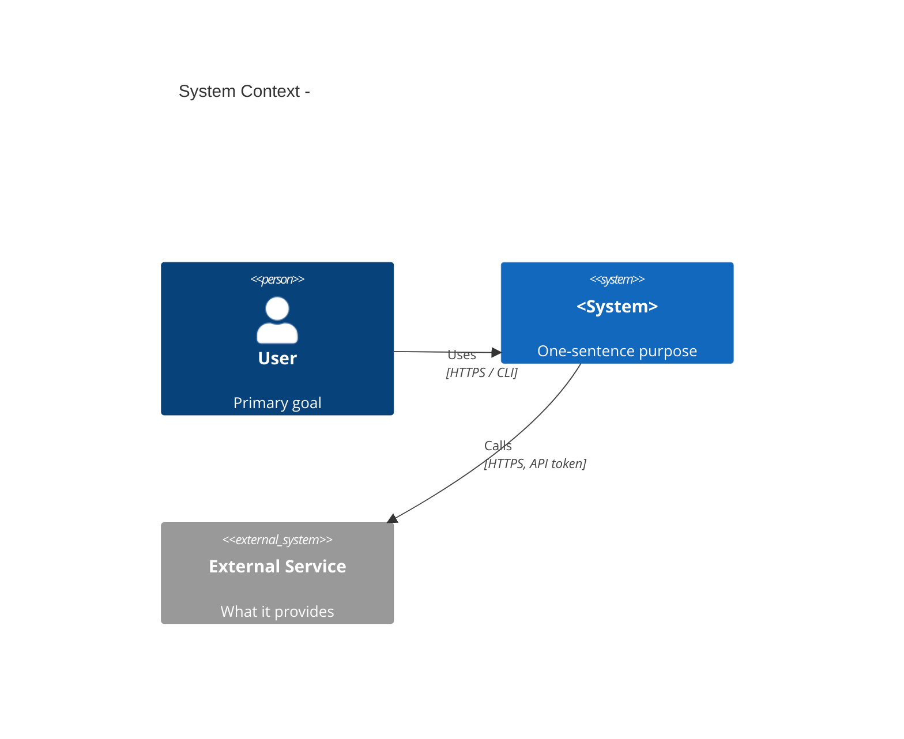
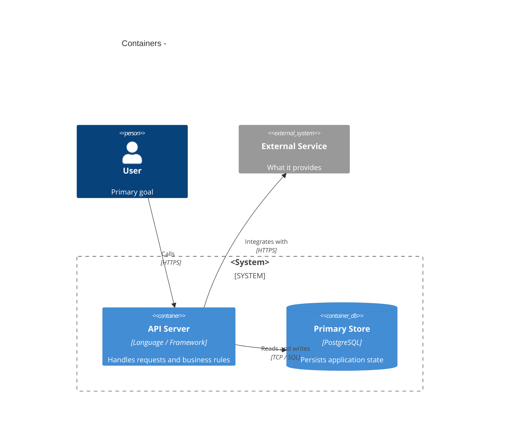
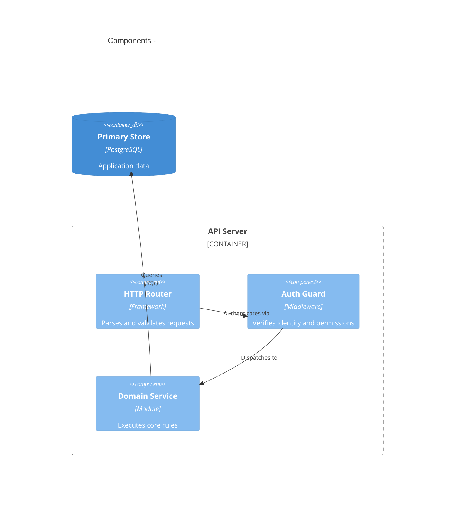

# Mermaid Conventions and Grounding Rules

## Mermaid C4 Diagrams

Keep each diagram focused (~15 elements max). Split into scenario diagrams or move attributes into tables when a diagram grows crowded.

### Context starter



### Container starter



### Component starter



### Diagram review checklist

1. Every element has a clear name and one-line responsibility.
2. Every `Rel(...)` has a verb; trust-boundary crossings include protocol or auth mechanism.
3. Arrow direction matches real call/dependency direction.
4. External systems use `System_Ext`, not `Container`.
5. Opening `{` and closing `}` braces match in every `System_Boundary` / `Container_Boundary`.
6. Diagrams and prose tables agree — never hide contradictions in prose.

## Grounding Rules (Facts vs. Proposed vs. VERIFY)

- **Fact:** directly observed in source code, manifests, config, or verified test output. State it directly.
- **Proposed:** documented design intent that is not implemented yet. Label it explicitly as `proposed` (and prefix unbuilt paths with `planned:`).
- **VERIFY:** unconfirmed owner, retention policy, deployment target, or runtime behavior. Write `VERIFY: <what needs confirmation>` instead of guessing.

Never put secrets, API keys, tokens, connection strings, real customer names, or production payloads in any `.md` file or diagram.

## Validator Error Codes (`src/check.js`)

| Code | Meaning | Fix |
|---|---|---|
| `c4/missing-directory` | Target `docs/c4` folder does not exist | Run `mc4 init` or create `docs/c4/` |
| `c4/missing-file` | Required index or level `.md` file is missing | Create the missing file from `templates/` |
| `c4/missing-title` | File has no `# Title` heading | Add a level-1 heading |
| `c4/missing-metadata` | Missing `Status`, `Owner`, or `Last reviewed` | Add the missing metadata bullet |
| `c4/invalid-status` | `Status` is not `draft`, `proposed`, `accepted`, or `verified` | Use one of the four valid values |
| `c4/invalid-date` | `Last reviewed` is not a valid `YYYY-MM-DD` date | Fix the ISO calendar date |
| `c4/readme-missing-level-link` | `README.md` does not link a required level file | Add relative links to `01`, `02`, `03` |
| `c4/unclosed-diagram` | A ```` ```mermaid ```` fence is never closed | Add the closing ```` ``` ```` fence |
| `c4/missing-diagram` | Required level has no Mermaid diagram | Add a supported Mermaid diagram |
| `c4/diagram-without-relationship` | Diagram has no `Rel(...)` or arrow | Show interactions between elements |
| `c4/unbalanced-braces` | Boundary `{` and `}` counts do not match | Balance boundary blocks in the diagram |
| `c4/broken-link` | A relative Markdown link points to a missing file | Fix the link target or remove it |
| `c4/source-not-found` | A backticked `Source:` path is missing or escapes repo root | Use a valid repo-relative path or `planned:` |
