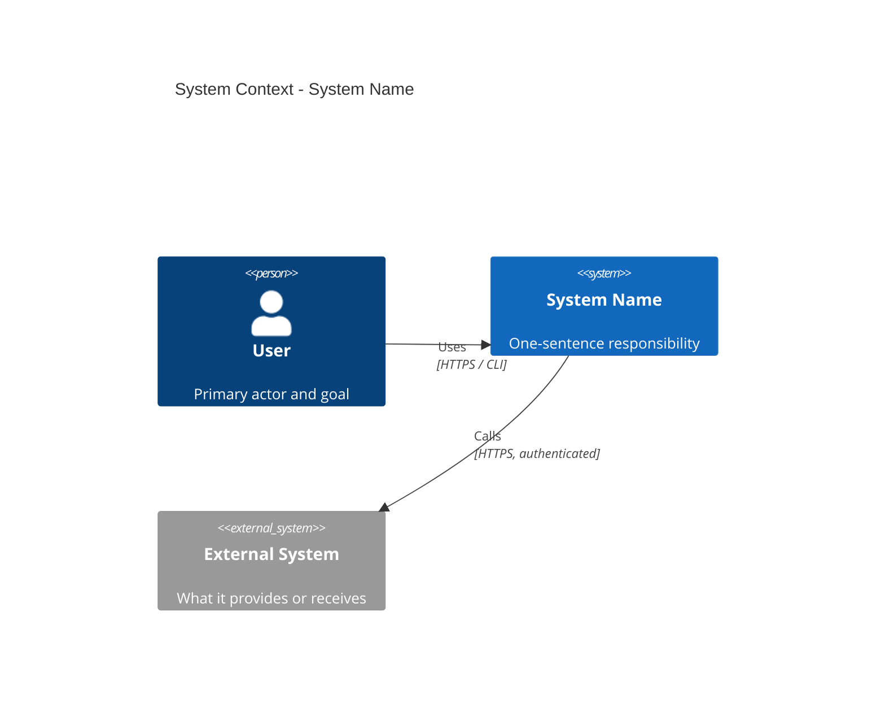

# System Context

- **Status:** draft
- **Owner:** VERIFY: assign architecture owner
- **Last reviewed:** 2026-01-01

One-sentence summary of what the system does, for whom, and what sits outside its boundary.

## External Systems and Ownership

| System | Purpose | Protocol / Auth | Owner |
|---|---|---|---|
| External System | What it provides | HTTPS / API token | VERIFY: owner |

## Scope and Trust Boundaries

- **In scope:** List core responsibilities owned by this repository.
- **Out of scope:** List external systems, upstream producers, or downstream consumers not owned here.
- **Trust boundaries:** State where caller identity and permissions are verified.
