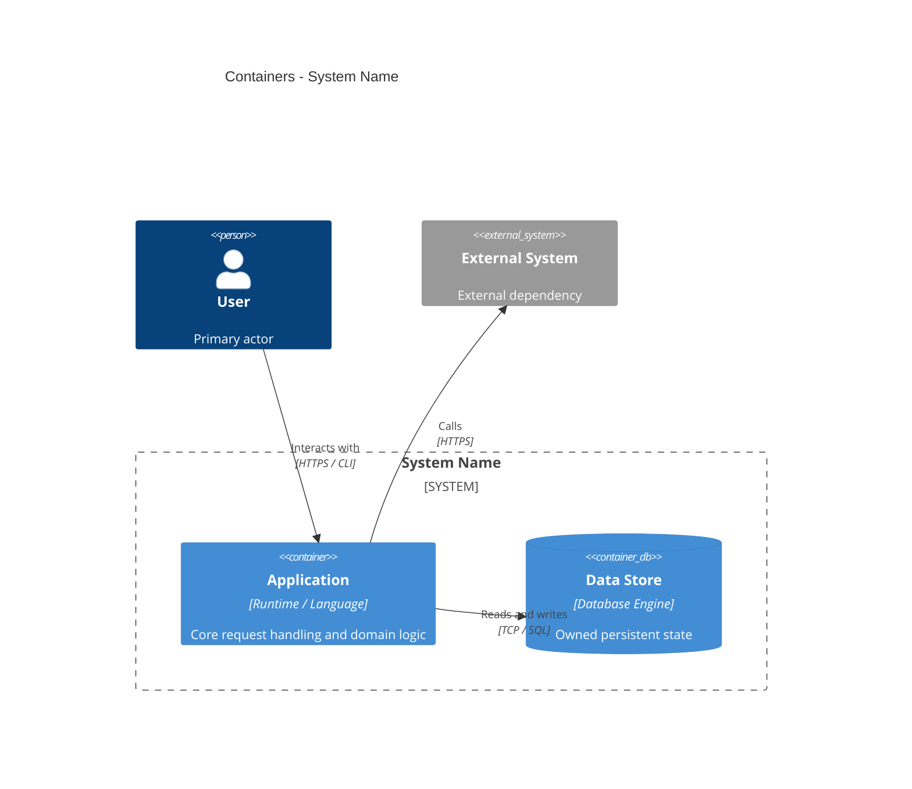

# Containers

- **Status:** draft
- **Owner:** VERIFY: assign architecture owner
- **Last reviewed:** 2026-01-01

Overview of the separately runnable applications, workers, and data stores.

## Container Inventory

| Container | Technology | Responsibility | Owned State | Identity / Auth | Status |
|---|---|---|---|---|---|
| Application | Runtime / Language | Core logic and API | None (stateless) | VERIFY: auth mechanism | draft |
| Data Store | Database Engine | Durable records | Primary entities | Service credentials | draft |

## Deployment and Failure Notes

- **Deployment:** `VERIFY:` record actual hosting/runtime target once confirmed.
- **Cross-boundary failures:** State timeouts, retries, and fail-closed behavior at external boundaries.
