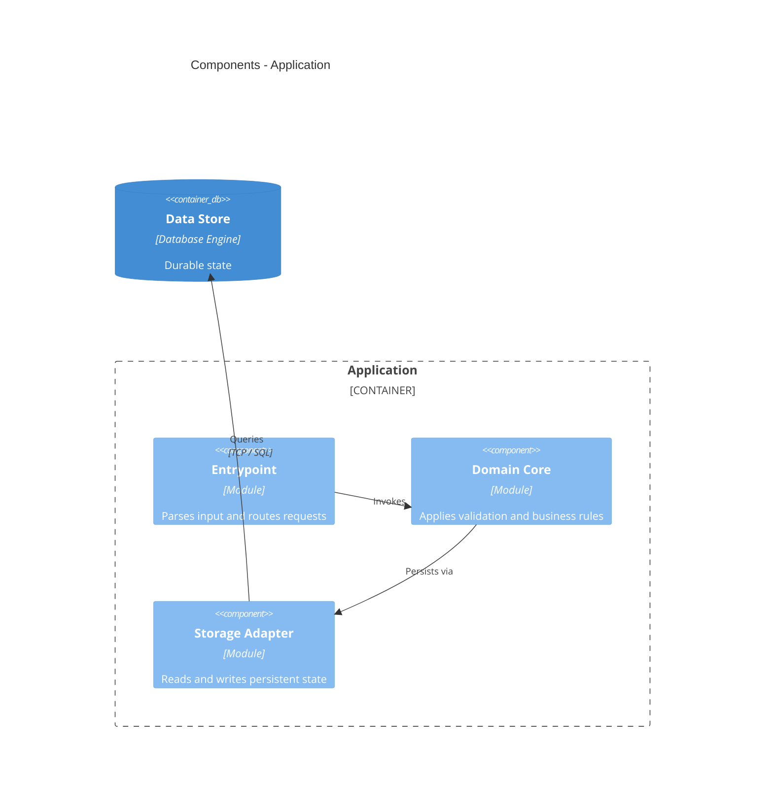

# Components

- **Status:** draft
- **Owner:** VERIFY: assign architecture owner
- **Last reviewed:** 2026-01-01

Decomposition of the main runtime container into its key logical components and source files.

## Key Components

### Entrypoint

- **Owner:** VERIFY: assign component owner
- **Source:** `planned: src/entrypoint`
- **Interface:** HTTP routes, CLI commands, or event handlers
- **Failure behavior:** Rejects malformed or unauthorized input before reaching core logic

### Domain Core

- **Owner:** VERIFY: assign component owner
- **Source:** `planned: src/core`
- **Interface:** Typed service functions and domain errors
- **Failure behavior:** Fails closed on invariant violations or missing dependencies
