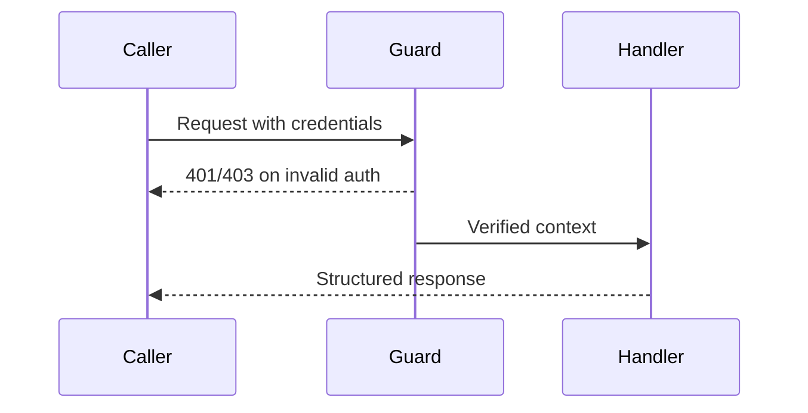

# Code Details

- **Status:** draft
- **Owner:** VERIFY: assign component owner
- **Last reviewed:** 2026-01-01

Optional Level 4 notes for complex state machines, protocols, or security-critical logic.

## Grounded References

- **Source:** `planned: src/handler`
- **Notes:** Link directly to the small number of modules where code-level detail prevents recurring bugs.
